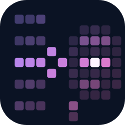

<p align="center">
  
</p>

<h1 align="center">EasyRAG</h1>

<p align="center">
  A simple, modular toolkit for Retrieval-Augmented Generation (RAG) research in Python.
</p>

Every stage of the pipeline (loading, splitting, embedding, storing, retrieving and generating)
is a small swappable component behind an abstract base class, so you can try new methods
without rewriting everything else.

## Installation

```bash
git clone https://github.com/HilthonTT/EasyRAG.git
cd EasyRAG
uv sync
```

Optional extras: `uv sync --extra openai`, `--extra anthropic`, `--extra huggingface`,
`--extra pdf`, `--extra faiss`, or `--extra all`.

## Quickstart

```python
from easyrag import Document, NaiveRAGPipeline

pipeline = NaiveRAGPipeline.from_config()
pipeline.index([Document(content="Paris is the capital of France.")])

response = pipeline.run("What is the capital of France?")
print(response.answer)
```

From the command line:

```bash
uv run easyrag index examples/data      # build and save the index
uv run easyrag ask "What is RAG?"       # or: easyrag ask --docs examples/data "What is RAG?"
uv run easyrag chat                     # interactive
uv run easyrag eval data/eval.jsonl     # score retrieval and answers on a question set
```

To try evaluation without your own data, use the example benchmark in
[examples/eval/](examples/eval/README.md):
`uv run easyrag eval examples/eval/questions.jsonl --docs examples/eval/docs --retrieval-only`.

Pipelines (`pipeline.type`): `naive`, `hyde`, `multi_query`, `iterative`, `self_ask` and `ircot`. For example,
`EASYRAG_PIPELINE_TYPE=self_ask uv run easyrag ask "..."`.

See [docs/architecture.md](docs/architecture.md) for how the pieces fit together.

## Configuration

Settings live in [configs/default.yaml](configs/default.yaml). Any value can be overridden with
an environment variable `EASYRAG_<SECTION>_<KEY>`, for example `EASYRAG_RETRIEVER_TOP_K=8`.
The defaults run fully offline (hashing embeddings, hybrid search, and an `echo` generator that
returns the prompt). Set `embedding.provider` and `generator.provider` for real models.
API keys go in `.env` (copy `.env.example`).
For large indexes, `uv sync --extra faiss` and set `vectorstore.provider: faiss` (with
`vectorstore.index: hnsw` for approximate search at millions of chunks).

## Docker

Put your documents in `data/`, then from the repo root:

```bash
docker compose -f docker/docker-compose.yaml run --rm easyrag index /app/data
docker compose -f docker/docker-compose.yaml run --rm easyrag ask "What is RAG?"
docker compose -f docker/docker-compose.yaml run --rm easyrag chat
```

The index is saved to `data/.rag_index`, so it survives the container. `configs/` and `.env`
are picked up as usual. Optional extras are installed at build time, e.g.
`EASYRAG_EXTRAS="anthropic pdf" docker compose -f docker/docker-compose.yaml build`.
For a local model, see the Ollama notes at the top of
[docker/docker-compose.yaml](docker/docker-compose.yaml).

The container runs as uid 1000. On Linux, if your user has a different uid, make `data/`
writable for it (or add `user: "${UID}:${GID}"` to the service).

## Development

```bash
uv run pytest           # tests
uv run ruff check .     # lint
uv run mypy src         # type-check
```

See [CONTRIBUTING.md](CONTRIBUTING.md).

## License

[MIT](LICENSE)
